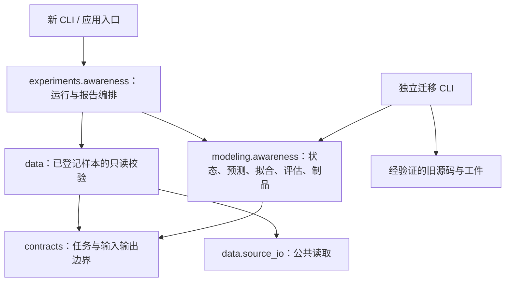

# 行动模型兼容迁移设计

2026-11-26；回应用户“按你的建议设计”，承接 [PR #51 的 D5 评审](https://github.com/xrfc/dota2-timing/blob/ef9c898b1e37dc4d14b035c973e3ebd7a1db6ee2/docs/reviews/2026-11-26-stage-and-architecture.md)。**状态：设计完成后待实施；本页 API、路径、schema 和迁移 ID 均为助手方案，尚未实现或激活。** 本轮不移动生产代码、不加载真实模型、不训练或重评原 337 场。

## 1. 推荐方案及理由

采用**两代并存、显式转换、逐步接入**：旧源码、旧模型和旧严格入口原样保留；新增分层实现与新格式，单独迁移入口在校验来源后只转换已拟合状态，写入新目录。新模型层不导入旧脚本，应用不会在校验失败后偷偷改走旧实现。

不先把旧脚本改成转发门面。旧 `check_freeze` 不只依赖类路径，还比对当前目录中 26 份来源的 SHA；换成同名门面同样会失配。直接改 `__module__`、全局别名或宽松反序列化，也不能解决源码校验问题。保持旧文件不动的成本是短期存在两代实现；用固定版本清单和等价回归控制它，后续再单独讨论旧入口退役。

本阶段范围限于“已冻结样本 → 模型/估计 → 评估与报告”。录像提取、机会筛选的深拆属于 D2，B5 新动作与新收益研究另行推进。结构迁移不引入通用插件平台、微服务或新依赖。

## 2. 已核实的旧版本

基线为 [PR #34](https://github.com/xrfc/dota2-timing/pull/34) 的 `7ca2ae3d14edae67042634f820a9456827d78ce1`。#34–#40 七个固定 head 的冻结清单与 26 份来源逐项一致；后续工作台虽有新增文件，没有改写这组旧来源。机器可读清单见[设计基线](acceptance/action-model-migration-baseline.json)，它只记录设计证据，**不是运行时迁移登记**。

| 绑定项 | 实际情况 |
|---|---|
| 冻结清单 | `u191-final/1`；SHA256 `ed7655af753a2e8fe4fbb99646fec649837433587aea4708bc60d26776487720` |
| 三份 domain 工件 | `wave.joblib`、`jungle.joblib`、`support.joblib`：字典、已拟合 sklearn Pipeline、分层/支持数/结果统计 |
| 参考模型合集 | `wave-reference.joblib`：七个参考模型，涉及五种项目自定义类；不能按 domain 字典同样处理 |
| 来源/环境 | 26 个来源条目；精确 Python/numpy/scipy/sklearn/joblib/Gem 版本；模型、地图、compat 各有绑定 |
| 读取链 | `outcome_final.check_freeze` 与 `new_replay_outcomes._frozen`；后者另查比赛独立性，不能随结构拆分取消 |

源码中的正式构造路由为 `scripts.lane_study_baselines` / `scripts.lane_study_sequence`。以下全名及字段是**源码证据**，没有反序列化真实工件，因此没有声称已检查其实际类型或 pickle GLOBAL 记录：

| 类全名 | 必须保留的已拟合状态 |
|---|---|
| `scripts.lane_study_baselines.ActionMeans` | `means` |
| `scripts.lane_study_baselines.TreeOutcome` | `columns, hits, death, death_rate, history` |
| `scripts.lane_study_baselines.BehaviorReference` | `farm_frequency, pipeline` |
| `scripts.lane_study_sequence.FeatureScale` | `median, scale` |
| `scripts.lane_study_sequence.SequenceOutcome` | `history, static_scale, sequence_scale, parameters, hits_mean, hits_std, constant_death` |

裸模块互导确实存在，但不能据此预先接受 `lane_study_baselines.*`、`__main__.*` 或测试加载器名。若后续受控检查发现其他实际全名，须补同版本生产证据和单独登记，不能以通配符兜底。

前轮评审将 PR #44 的纯评分核写成 `data.decision_score`，目录名有误：实际为 [`modeling/awareness/decision_score.py`](https://github.com/xrfc/dota2-timing/blob/5cc726716229dec72725effa22584907d20fdda3/src/dota_items/modeling/awareness/decision_score.py)。本设计保持它在模型层，不搬到 data；其“主张检查”也不同于 `outcome_values.score` 的事后结果评价。

## 3. 研究语义不随搬迁变化

| 项目 | 迁移必须保留 |
|---|---|
| 动作 | wave：`farm/retreat`；jungle：`continue_jungle/leave_camp`；support：`approach/stay`；原顺序不变 |
| 时间/特征 | 事前帧 `t−10,t−5,t`；wave 静态 7 列、另两域 10 列，序列每帧 7 列；列名、列序、缺失和预处理逐项绑定 |
| 标签 | 前六秒识别动作，后续至 t+20 的旧结果语义；`gold` 是现金余额 `t+20 − t+6`，不是新分类实收；升级造成的经验未知等规则保留 |
| 划分/排除 | 原 `lane-study-v1` 整场五折、U133 留出隔离；未知动作、早死、截断与原 eligibility/排除记录不变 |
| 学习/输出 | 随机种子、参数、训练侧填充/缩放、列掩码、常量类别、支持门槛、分层、平衡判定、取舍与未知输出不变 |

新 B5 的 `stay_lane/move_to_jungle` 和 30/20 秒分类实收属于另一任务，**不能仅重命名旧动作或替换 gold 字段**。未来实验另给任务版本与研究协议。本次并不把旧模型的观察性比较升级为因果效果或有效推荐。

## 4. 目标结构与 API

所有新业务模块登记 `awareness`；共享目录的 `__init__` 不导入它们。下图为拟议结构，箭头表示代码依赖：

`modeling` 不依赖 data/sources/workflow/scripts；`data` 不依赖 modeling/experiments；新业务包不加载旧 CLI。迁移 CLI 是唯一有意保留的旧→新桥，放入口层，完成后也不作为模型或应用的运行依赖。

| 拟议文件（均未创建） | 责任与主要 API | 原职责来源 |
|---|---|---|
| `contracts/action_outcomes.py` | 标准库的任务/列序/动作/结果/迁移记录校验；`DecisionInput`、`ObservedOutcome` 分开 | 固定任务参数和字段顺序；不搬入任何读取/拟合 |
| `data/action_outcome_inputs.py` | `read_development_bundle(path, expected_identity)`；检查 schema、全文摘要、重复键、match/fold/eligibility 后返回样本与来源 | `outcome_values.read_dataset` 等读取部分；使用 source_io，保留全部机会的清单统计 |
| `modeling/awareness/action_features.py` | `encode_decision`、已学缩放的 `transform`、严格状态形状检查；不拟合统计量 | `_features/_inputs/_design` 的预测侧计算及 FeatureScale.transform |
| `modeling/awareness/action_models.py` | 无 fit 的已拟合状态类型；`from_state/to_state`、hits/death/行为概率预测 | ActionMeans、TreeOutcome、BehaviorReference、SequenceOutcome 的状态/预测；序列前向计算 |
| `modeling/awareness/action_values.py` | `estimate_actions`、支持分支与取舍；不附加未来真值 | `estimate/pareto`，消费已拟合倾向/分层状态 |
| `modeling/awareness/action_training.py` | `fit_reference`、`fit_action_values`；训练侧统计/优化在此，数据须由调用方提供 | 类的 fit、FeatureScale.fit、`fit_value` 及训练助手 |
| `modeling/awareness/action_evaluation.py` | `join_observed`、`evaluate_factual`、分组摘要；只接收明确的预测与结果 | 旧 `score/summary/population_summary` 与参考指标，防止把未来结果混入预测 |
| `modeling/awareness/action_artifacts.py` | `inspect_bundle/load_bundle/write_bundle`；schema/成员/摘要/版本核验及显式状态构造 | 新格式；不导入拟合入口或 data.producer_migration |
| `experiments/awareness/action_runs.py` | 显式编排开发折、模型调用、结果写入；`train_development/predict_prepared/evaluate_saved_predictions` 分开 | `lane_study/outcome_values/outcome_final` 中运行部分；不迁入原留出 prepare/evaluate 的可执行入口 |
| 新 scripts 入口 | 仅 argparse、调用公开 API、退出码；迁移入口单独命名 | 旧 scripts 保持原字节，新 CLI 不取代旧命令名 |

最小 API 约定：

- 模型内部方向固定：FeatureScale 的状态/transform 属 features，models → features，training → features/models/values，artifacts → 明确的状态构造；预测路径不导入 training。`action_runs` 只在显式训练函数内部加载 training，不能在包的 `__init__` 或预测启动时把训练模块重新聚合回来。
- `predict_outcomes(state, decisions, proposed_actions)` 的动作是显式指定的候选，不能从结果表偷偷获取；`predict_behavior(state, decisions)` 不接受动作标签；`estimate_actions(state, decisions)` 同时返回既定两种动作的结果及支持原因。
- `ObservedOutcome` 在计算预测之后才由 evaluation 以 `(match, hero, t, domain)` 合并，禁止按列表位置默配；key、fold、观察动作是审计/评价字段，不自动进入数值特征。
- 拟合只接受训练分区已验证的决策、观察动作和结果；不在模型函数里选目录、重分折、补采或回退训练。输入契约记录任务来源，不把布尔参数当作用户研究授权。
- baseline/behavior 只消费末帧，旧合成接口允许前两帧为空；SequenceOutcome 在旧实现中即使 `history=False` 也检查三帧形状。空输入/未知动作的历史错误行为不顺手统一：ActionMeans 对未知动作返回 NaN，Tree/Sequence 拒绝，Behavior 不消费动作；逐家族做兼容测试。
- 树与 Pipeline 推理可以使用 sklearn；纯数值序列预测与 `scipy.optimize.minimize` 分开。目标是推理不调用拟合、不依赖训练入口，不承诺所有模型都能脱离 sklearn。

## 5. 新制品与显式迁移

### 5.1 三条互不混淆的路径

| 路径 | 校验与含义 |
|---|---|
| 旧严格读取 | 原 freeze、源码、环境、模型等全部精确匹配；保留原入口，不称新实现复现 |
| 显式转换 | 仅接受已登记旧 freeze/工件；复制已拟合状态到新布局，独立写迁移收据；不 fit、不补缺值、不改研究字段 |
| 新严格读取 | 只读新 schema 和完整指纹；不 fallback 到旧脚本，不以旧 freeze 冒充新来源 |

转换只能处理登记的可信本地工件，不能变成任意上传 joblib 的通用服务。哈希证明与登记字节一致，不是对任意文件的安全认证。

### 5.2 拟议格式

使用新 `awareness-action-model/1` manifest，不改写 `u191-final/1`。首版保持已有 sklearn 后端，不引入另一推理引擎：

- `manifest.json`：模型家族/任务/输入列序/结果顺序、用途、原数据与 fold 摘要、完整依赖版本、新实现清单和载荷 SHA；迁移得到的包另含原 freeze/模型摘要和迁移 ID，不含迁移收据哈希。
- `state.joblib`：白名单字典、标量、数组以及实际预测需要的 sklearn 对象；项目自定义状态用字段和值表示，**不再 pickle 项目模型类实例**。读取后由固定 family 分发构造新状态，不从文件提供的任意模块名 import。
- `migration.json`：原工件身份、完成后的新 manifest/载荷 SHA、实现变更、状态比对、预测 parity 范围与结果；不得声称新训练或重新独立验收。哈希方向为载荷 → manifest → 收据 → 外层验收记录，避免 manifest 与收据互相包含哈希。

domain 字典与参考合集分别转换。参考合集的七个模型键及五类嵌套状态必须完整；列掩码、数组 dtype/shape、学习参数和常量分支逐项校验。domain 的 `common_range` 等字段按原分支检查（例如单一动作时可能不存在），不能补造默认值。新包不保证序列化字节与旧 pickle 相同，要求保存的学习状态与预测语义一致。

### 5.3 迁移登记与执行顺序

拟用独立 ID `u191-action-layout/1`；实现前登记为 `design-only/disabled`，新实现 SHA、实际类型核验和 parity 收据保持未完成。记录必须包含：

1. 固定旧 freeze SHA、26 份来源/四份工件 SHA、环境与关联地图/compat 身份；实际检查后确认的项目类全名和工件布局。
2. 新 schema、完整新实现指纹、入口和载荷白名单；任务、特征、参数、折、结果窗口和原研究数据来源摘要。
3. 精确允许的变动：代码身份、项目类表示、序列化布局；其他语义逐项相等，不做“删除所有哈希后比较”。
4. 验收报告身份、校验范围、激活状态。没有目的实现 SHA 和通过证据的记录不能发布正式转换结果。

状态顺序明确为 `design-only → candidate → validated`：design-only 不加载真实工件；candidate 已绑定完整旧/新来源，只允许内部合成试转换及后续实施范围内的受控只读类型核验，结果写隔离的测试目录并标为不可供生产使用；来源、实际类布局与合成 parity 验收齐备后登记为 validated，才允许正式转换。每次正式转换仍须核对来源并完成本次状态/预测 parity 才能原子发布，不能沿用历史测试作为该次数据一致性的替代。候选流程和正式流程不得用一个随意的 `--ignore-validation` 开关互通。

既有 `data.producer_migration` 专门服务 `public-reader/1`，**不扩成通用兜底**，模型层也不能导入它。借鉴其严格默认/明确登记原则；新格式核验在 contracts/artifacts，跨层迁移收据由入口/编排写入。

转换流程：先检查登记和全部来源 → 固定输入字节/来源快照 → 独立进程中加载可信旧状态 → 无 fit 地导出新状态 → 新进程加载新包并做预定合成输入 parity → 复核旧输入/实现未漂移 → 原子发布到全新目录。旧源码可按精确 Git 文件和 SHA 建立只读快照，保留原包路径；不新建 worktree、不覆盖当前源码或通过全局 `sys.modules` 给应用注入别名。桥接进程退出后不得影响新应用的导入路径。

任一不匹配即失败，不“修复”旧工件、不忽略环境变化、不自动重训。输出已存在则拒绝；失败不触碰旧文件，临时结果不发布。恢复使用旧入口需要显式选择匹配的旧源码/环境；不存在自动降级路径。原留出启动标记保持原字节，不复制/删除标记以重获评分机会。

## 6. 分步交付与验收

每步一个主题 PR；在前置尚未合并时先固定交接版本，不能把“各分支通过”当作组合验收。具体文件路径属实现方案，实际新模块创建时才加入 `architecture.py`，避免把不存在的模块登记成 active。

| 步骤 | 可审阅交付 | 退出条件 |
|---|---|---|
| M0 本轮设计 | 旧来源/类状态清单、本设计、未激活登记字段、任务边界、测试矩阵 | 源码/清单核对与文档检查通过；明确尚未验证真实模型兼容 |
| M1 契约与纯推理 | 输入/状态契约、features/models/values/evaluation；旧生产者不改 | 五类状态、三个 domain 与七参考键的合成预测 parity；导入/调用隔离；语义和错误分支一致 |
| M2 训练与运行分离 | training 与开发编排、已登记样本读取；只执行合成训练回归 | 同种子合成拟合结果等价；填充与缩放只在 train 拟合；折和未知规则无漂移；不启动真实训练 |
| M3 制品与迁移桥 | 新制品读写、只读核验/显式转换入口、精确迁移登记 | candidate 用合成旧工件通过全矩阵并完成受控类型核验；实际类型/环境/新实现身份补齐前不能发布正式包。真实工件的核验在后续实施中单独记录范围，不读取留出作 parity |
| M4 应用接入 | 新 CLI/复盘入口显式选择新 schema，旧路径仍可追溯 | 新报告固定输入的结构/数值/未知原因回归；模型专项归属和全量验收；不改排序标准或触发自动训练 |
| M5 可选退役 | 旧调用方盘点、保留旧生产者快照的兼容提案 | 另行提出后才替换旧门面/退役；不作为新分层实现可用的前置 |

**关键回归矩阵（后续实现时执行）：**

- 预测：五类状态、各参考键、两动作/单动作、全缺列、列掩码、常量死亡、缩放和历史开关；覆盖不支持、支持稀少、边界分层、缺目标、取舍/平局。旧实现独立进程对比新实现，不能两侧调用同一个新函数充当独立基准。
- 结果标准：状态数组 dtype/shape/数值、离散 key/None/分支完全一致；固定旧环境且保持计算顺序的迁移预测要求数值精确相等（NaN 位置相同）。如发现数值差异先定位，不按结果放宽容差或将其算作模型改进。新序列化字节不同不构成失败。
- 信息边界：预测输入不能取得观察结果；在纯特征/预测层的兼容测试中，向旧完整样本追加/改变 gold/death/fold 等非特征字段，特征和预测应不变。读取层仍必须拒绝错误 fold；该测试不是放宽人口/划分核验。候选动作只在显式条件预测接口进入。
- 拒绝路径：错来源/载荷/环境/家族、未登记类、字段或形状缺失、输入途中变化、输出已存在都拒绝；验证不调用 `fit`、`minimize`、原 `freeze/prepare/evaluate`，不加载旧留出数据。
- 架构：新包→scripts、modeling→data、共享→B、A↔B、显式循环为零；纯状态/预测不导入新的训练模块，序列预测不加载 optimize。迁移桥的旧脚本加载只在独立入口进程内。
- 专项归属：至少 `test_lane_study_baselines`、`test_lane_study_sequence`、`test_outcome_values` 的后继测试进入 modeling；数据与跨层测试保留 data 双归属。不能仅靠“是否 import modeling”自动判断旧脚本测试。
- 发布：输入/旧工件/旧来源/旧一次性评估标记前后摘要稳定；新制品只写新目录；最终串行全量验收含未跟踪源码指纹。失败保留诊断和旧包，不以重签旧清单收尾。

## 7. 本轮完成与未完成

本轮完成设计与固定 Git 来源核验，没有启用迁移、反序列化真实工件、执行拟合/预测或读留出。实际工件类型和状态布局、转换后的预测等价、真实消费方回归，均是后续实现的验收项，不把文档或测试清单当作已经通过。

本轮工程验收仍使用计划 §0 的 `scripts/check.py --scope all`，日志位于 `reports/action-model-migration-design-20261126/check-final.log`，同目录记录含未跟踪源码的前后指纹；结果随本设计 PR 交付。设计另经独立源码/兼容边界复核，记录在同目录 `review-agent/`。这些检查不代替未来迁移的合成或真实工件验收。

计划的下一项是 **M1 契约与纯推理的合成实现**，先完成 M0 交接版本核验；D4 营地投影问题仍为独立主题。用户已同意“设计”，本页不把技术建议、研究选择或真实迁移执行说成已获逐项确认。
