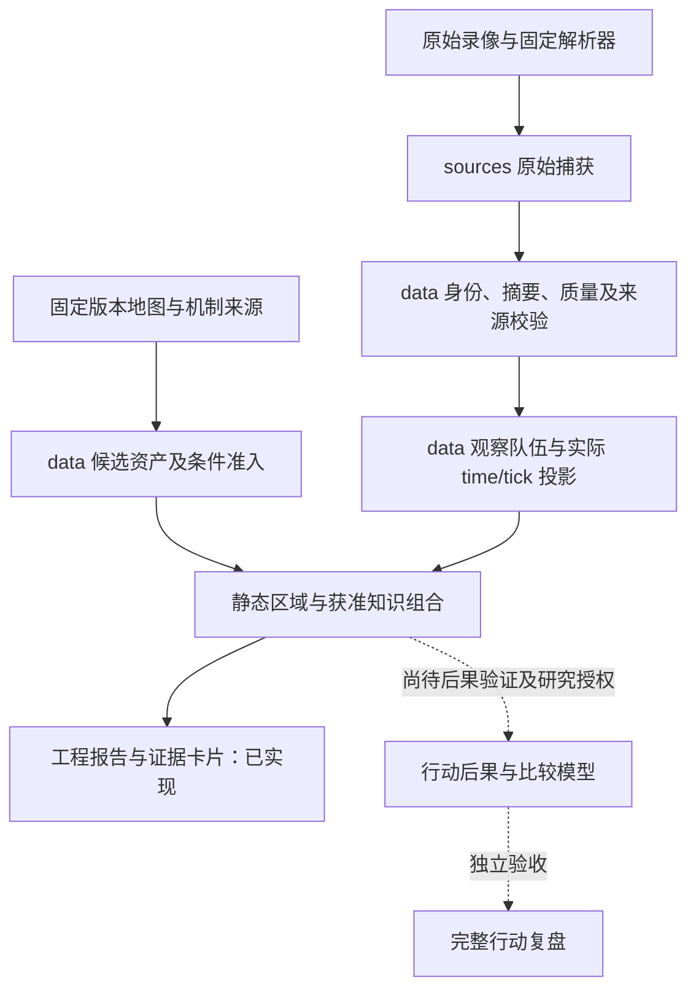

# 近期开发总结与架构复核（2026-11-27）

本轮整理基于本地截至`9339de0`的六个7.42主题提交；只改文档，不改变数据口径、研究选择或生产者。当前一号位意识复盘为主线、路线A暂停。执行状态仍以[计划§7](development-plan-2026-10-30.md#7-状态表唯一进度来源)为准，本页为阶段快照，不另建路线。

## 1. 进展与实际可用程度

| 阶段 / 提交 | 已完成 | 仍不能据此认定 |
|---|---|---|
| 来源绑定 `a1df6e7` | 精确7.42、地图与机制来源摘要，五场build6993几何对账；对应地图来源build6989显式记录 | 同补丁不同build天然等价，或7.42a自动继承 |
| 行动资产 `cc4e05e` | 28营地、静态路径/视线与56探针，机制档案、克制图、特性、保命/机动候选 | 动态路径、完整FOW与实际技能交互均已验证 |
| 补证 `151cee6` | 原五场＋批准三场长局；22直接营地类型候选、6动态阶段；肉山5死亡、2复活区间、3右删失 | 6处永久类别、完整复活规则、痛苦魔方复活已有正样本 |
| 时点接口 `e82584e` | 15445游戏秒、154450本体样本、308900双队标签；120观察卡片、30890精确查询与61780截断检查 | 目标可见标签等同于有效视距、完整坐标FOW或来源归因 |
| 机制消费 `b1dfbde` | 14条补证重算；3292行＝2496候选可用＋700排除＋96未准入；8提升、1降级，派生同步条件 | 候选可用等于用户批准或逐项效果认证；现有批准仍8行 |
| 原始探针 `9339de0` | 150栖树索引，87稳定片段支持86局部对应；8场S2扫描；非空容器存储槽、原字段及无损差分保留 | 2394棵树全映射、有效容器成员、临时视野单位/类型/时效已知 |

树探针94,253,072字节，相对同内容完全展开参照节省91.24%；这是编码节省，不是模型效果或与gzip的比较。S2未见TREE_CUT消息不能证明没有砍树。详见[原始探针与验收](patch-tree-probe.md)。

既有7.41f带线/打野/补刀前评审和死亡风险基线继续保留。近期成果主要提高输入和证据可信度，尚未完成各行动后果、收益风险排序或可信行动比较模型。**正式知识入口仍7.41f，7.42完整行动复盘和训练准入仍关闭。** 采集解析改进在独立[PR #55](https://github.com/xrfc/dota2-timing/pull/55)；本页六轮代码在[PR #56](https://github.com/xrfc/dota2-timing/pull/56)，不能把分支成果写成main已经发布。

## 2. 代码导航与数据流

登记表包含228个Python模块（含包入口）、161个顶层Python脚本。shared为109活跃/23维护模块、74脚本；A为18/36、38脚本；B为39/3、49脚本。登记为active表示代码可扩展，不表示产品线当前正在推进。

| 目录 | 职责与规模 | 阅读入口 |
|---|---|---|
| `src/dota_items/sources/` | 19模块；外部数据、Gem解析和新鲜证据捕获 | `gem_replay.py`、`map_tree_probe.py` |
| `src/dota_items/data/` | 134模块；公开读取、身份、版本、知识、时间与观察者投影 | `source_io.py`、`patch_assets.py`、`patch_decision_view.py` |
| `contracts/`、`handoff/` | 6＋2模块；标准库契约及只读传输 | `contracts/death_risk.py`、`handoff/bundle.py` |
| `modeling/` | 29模块；规格/批处理、训练/估计器、制品/推理、评估 | `specs.py`、`training.py`、`inference.py`、`awareness/death_risk_eval.py` |
| `experiments/`、`workflow/` | 10＋13模块；实验及工作区编排 | `experiments/awareness/`、`workflow/` |
| `recommendation/` | 7模块；旧规则推荐 | 仅维护，与B线不互相导入 |
| `scripts/` | 161顶层Python入口；运行、发布、页面与检查 | [脚本导航](../scripts/README.md) |

数量含`__init__.py`；根级8模块另计。完整归属及强制边界见[架构入口](architecture.md)，不按目录名猜产品线：`data`和`sources`都同时有共享与B线模块。

编排由CLI调用上述组件，叶子模块不反向导入CLI。全知/未来结果仅用于事后标签和核验，不能流回决策时视图。图中不把探针的所有原始字段画成已获准输入。

## 3. 结构评审：分层有效，低耦合仍有边界

现有测试强制sources不导入data/modeling/workflow、data不导入modeling/workflow、模型不依赖来源层、共享不导入A/B、A/B不互相导入，且每个模块/脚本都要登记。模型规格、制品和推理叶子另有不加载训练库的测试。近期时点接口和机制准入按来源、计算、投影、发布拆分，方向合理。

以下是本轮源码复核发现的维护债务和助手建议，不是已授权的研究选择，也不等于现在存在结果错误：

| 优先级 | 具体证据 / 影响 | 建议与验收条件 |
|---|---|---|
| 优先随下次解析演进处理 | `capture_tree_probe.py:54`与`capture_patch_evidence.py:35`动态载入`capture_map_runtime.py`并调用`prepare()`；CLI间存在隐式API，静态导入测试看不到 | 新版将固定解析环境准备放入独立编排服务，CLI只传参数；先登记生产者迁移，验证旧回执拒绝失配、新旧数据等价及失败不发布 |
| 优先随下次容器消费处理 | 树探针保存的是FieldState存储槽；长度丢失使“有槽”不等于“当前成员” | 定义独立的原始数组/逻辑长度/成员状态契约和新解码版本，保留未知；测试清空、缩短、索引复用、快照和差分重放 |
| 按需求逐步治理 | `data`134模块；`mechanics_action_assets.py`1014行、`patch_camp_semantics.py`733行、`map_tree_probe.py`732行，变更面较大 | 先按职责建立API导航和来源闭包；下一新生产者可拆schema、编码、采集与领域计算。行数只提示审查范围，不作为机械拆文件依据 |
| 集成时处理 | 架构旧文档仍写“B线有第一张页面再抽外壳”，但B线已存在独立页面 | 已修正文档；统一外壳保留待办，先约定路由/页面注册与隔离测试，不把页面合并列为当前7.42证据前置 |
| 持续补充 | AST测试识别导入边，不检查动态加载或跨线文件消费；哈希校验也不判断数据是否事前可知 | 继续用真实身份、留出排除、时间截断、隐藏/未来扰动及显式用途门禁补充，不宣称“通过架构测试＝完全低耦合” |

保留冻结源文件路径和旧字节是复现契约，不是随意整理目录的理由。任何物理迁移先登记旧指纹→新实现，不跳过哈希；本轮没有搬文件、修改捕获生产者或重写历史产物。

## 4. 接续顺序与停止条件

沿用计划§7，先在已有八场工程录像内解决完整树ID空间映射、原始容器长度更新及临时viewer单位/类型/时效，再收敛有效视距与归因。

随后补六处动态营地条件/区域语义、目标完整计时与痛苦魔方证据、剩余机制准入和交互条件。缺少正样本时保留未知，新采集范围另定；[G/A/N待决清单](patch742-open-decisions.md)需要用户裁定的项不能由工程默认值代替。

这些满足后再推进各行动后果、时点收益和风险验证。模型阶段须先确定标签、损益权衡与评价口径，再另行授权训练及最终留出评估；不据当前工程测试数估算模型完成百分比或承诺工期。

## 5. 核验口径

本轮为文档整理与源码结构复核，不重跑录像提取或真实训练。前轮已验收2880项pytest、22项unittest、36项Node测试，证据见[树探针验收](acceptance/tree-probe-20261127.json)；本轮首遍全量检查同样全部通过；期间修正了本页“六个提交”的措辞，因此按协作规则对定稿再做全量检查与前后文件指纹核验。最终证据记录于本地`reports/architecture-review-20261127/`，首遍另存`first-pass-with-doc-edit/`。历史专项原始记录保持不变。
